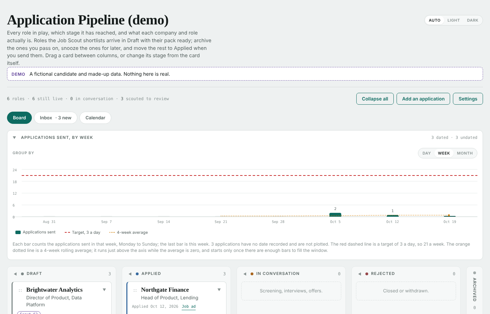
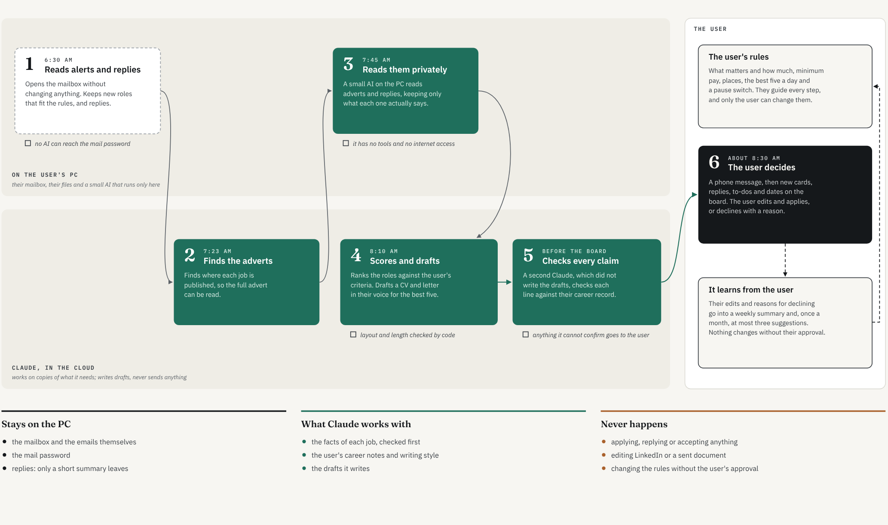

# Job Scout (demo copy)

Job Scout is an automated job search for one person. Each morning it reads the job alerts that arrive by email, drops the roles that clearly do not fit, and asks an AI to score the rest against the candidate's own career record. For the best few it drafts a tailored CV and covering letter, has a second AI check every claim in them against the record, and puts each one on a private board as a draft for the candidate to review. It also reads the replies to applications and suggests where each card should move.

**It never applies, submits, replies or contacts anyone.** Every decision stays with the person using it.

This repository is a **demo copy**. It runs on made-up data: an invented candidate (Sam Calder), invented companies and addresses that end in `.example`, which no real site can use. The private copy it was exported from runs on real alerts and a real record. This copy was built by an export that copies only an allow-list of files and fails on any of the owner's private details (names, applications, addresses, keys); the candidate's career story is modelled on the owner's, with every name, employer, date and figure changed.

Designed and directed by its owner, built with Claude (Anthropic) as the coding and writing partner.



## How it works



The work is split by what each part is trusted to see:

1. **Reading the mail (code, on the PC).** Plain TypeScript reads the alert emails, removes duplicates and drops roles that fail the hard rules (level, place, pay). No AI.
2. **Reading the adverts (a local model, on the PC).** A small model run by Ollama reads each advert and turns it into structured facts. It has no tools, and the advert text does not leave the PC at this step.
3. **Scoring (Claude, in the cloud).** Claude scores each role against the career record with a fixed rubric of eight criteria ([procedures/RUBRIC.md](procedures/RUBRIC.md)), following [procedures/SCOUT.md](procedures/SCOUT.md).
4. **Packs and review (Claude, in the cloud).** For the shortlisted roles Claude drafts the CV and letter ([procedures/PACK.md](procedures/PACK.md)). A separate reviewer agent, which did not write the pack, checks every sentence against the record ([procedures/REVIEW.md](procedures/REVIEW.md)). Anything it cannot match goes on the candidate's sign-off list.

Every AI output is checked by code (`tools/validate.py`) before it is written anywhere. Text written by strangers (alerts, adverts, replies) is treated as data, never as instructions; the demo includes a hostile advert and a fake offer to show this.

## What it never does

- Apply for a role, submit a form, or send anything to an employer.
- Reply to, accept, decline or book anything from an email, or open a link in one.
- Act on instructions found in an advert or an email.
- Write the board's settings, or change a card it did not create, except by the reply rules. Until the user has graded the reply reader on their own replies, every move is only a suggestion; after that, each move is logged and has Undo.
- Claim anything the career record does not support.

## Running the demo

You need Node 22.18 or later and Python 3.11 or later. Ollama is optional: without it the demo runs and says the local reader was skipped.

```
npm install
npm test                  the TypeScript tests
npm run test:tools        the Python tests (on macOS or Linux, where the command is python3:
                            python3 -m unittest discover -s tools -p "test_*.py")
npm run demo              a demo run on the made-up alerts, written under data/demo/<date>/
npm run demo -- --reset   clears data/demo/
```

It was built for Windows: the PowerShell scripts in `scripts/` and the morning schedule are Windows-only, and paths in the procedures use backslashes. The tests and the demo run anywhere with Node and Python.

`npm run demo` is the code half of a morning run. The AI half is done by Claude following [demo/DEMO.md](demo/DEMO.md): it scores the roles, builds one pack and puts the results on a demo board. To do that yourself, publish `demo/board/demo-board.html` as a Claude artifact with the `db` and `user` capabilities (it keeps its cards in the artifact's own database), put its id in `config/boards.json` under `demo`, and ask Claude to "run the Job Scout demo for today". The five-minute walkthrough is [docs/DEMO-SCRIPT.md](docs/DEMO-SCRIPT.md).

## Where to read more

Start at [docs/README.md](docs/README.md). The documents are written for readers rather than maintainers: how it is built, a one-page system card, the architecture, the agents, the threat model and risk register, the data, configuration, testing and decisions.

## Licence

All rights reserved. Shared for reading; not licensed for reuse.
